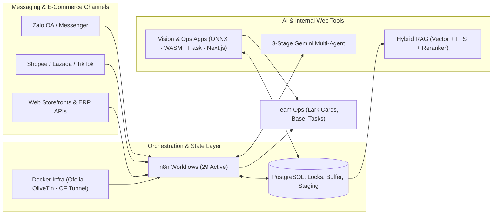

# Hi, I'm Vo Duy Bao Khanh 👋

### Full-Stack Developer & AI Automation Engineer · Ho Chi Minh City, Vietnam

*Architecting Multi-Agent AI workflows, concurrency-safe backends, and self-hosted automation systems.*

---

## ⚡ Engineering Highlights

| Focus Area | Production Experience |
|---|---|
| **Experience** | **4+ years** across Backend, Full-Stack Web/Mobile & Automation (`2022 – Present`) |
| **Workflow Orchestration** | **29 active n8n workflows** (`45` total, `500+` logic nodes) running on self-hosted Docker |
| **AI Concurrency & Cost** | **~60% LLM token reduction** via PostgreSQL Distributed Lock & JSONB debounce buffer |
| **Data Reliability** | **0s service downtime** via atomic Blue/Green staging table swaps & SQL integrity checks |
| **Omnichannel Systems** | **500+ daily chatbot messages** + idempotent multi-marketplace webhook routing |

---

## 🧠 About Me

I build production systems where **AI agents, operational pipelines, and full-stack web tools** work together reliably under real traffic.

- **Core Specialization:** Multi-Agent LLM orchestration (`Google Gemini`, `LangChain`), Hybrid RAG knowledge assistants, concurrency-safe PostgreSQL backends, and self-hosted Docker automation.
- **Engineering Principles:** I focus on **data consistency, idempotency, distributed locking, and self-healing integrations**—preventing webhook race conditions, duplicate alerts, broken OAuth token rotations, and partial sync failures.
- **Full-Stack Background:** Experienced across `TypeScript`, `Node.js` (`NestJS`, `Next.js`, `Express`), `Python` (`Flask`, `Streamlit`), `Go`, and cross-platform mobile (`React Native`, `Flutter`, `Kotlin`).

---

## 🏗️ System Architecture Focus

> Scheduled sync chains run **4×/day** with automatic catch-up recovery after host sleep/clock drift, while Blue/Green staging swaps prevent empty-table overwrites.

---

## 🛠️ Key Systems & Technical Patterns

### 1. Multi-Agent AI & Knowledge Retrieval
- **3-Stage Conversational Sales Agent (`120` n8n nodes):** Decoupled customer journeys (`Needs Analysis → Real-Time DB Quoting → Checkout`) using Gemini Pro/Flash, LangChain, and Gemini Vision for image/spec parsing, with instant human-takeover detection and bot-echo filtering.
- **Permission-Aware Hybrid RAG Assistant:** Knowledge platform combining 1024-dim vector similarity + unaccent full-text search (RRF) + `bge-reranker-v2-m3`, contextual query expansion, citation highlighting, and `DENY`-first RBAC/ACL folder inheritance on PostgreSQL `ltree`.

### 2. Concurrency Control & Event-Driven Pipelines
- **PostgreSQL Distributed Lock & Debounce Buffer:** Coalesces rapid multi-message customer bursts into a JSONB buffer before invoking LLMs, eliminating race-condition replies and cutting token overhead by ~60%.
- **Idempotent Omnichannel Order Router (`81` n8n nodes):** Webhook ingestion guarded by `INSERT ... ON CONFLICT DO NOTHING`, 6-hour self-healing webhook re-registration, nightly digest queues, and in-place card updates for urgent orders.
- **OAuth2 Lifecycle & Real-Time Sync:** Automated marketplace rotating `refresh_token` management (with IP-whitelisted API calls) and `<2s` webhook-driven catalog/price synchronization.

### 3. Computer Vision, Browser WASM & Ops Tooling
- **AI Product Banner Studio (`NestJS` + `Next.js 15`):** Automated `1024×1024` cover editor powered by worker-thread `RMBG-1.4` & `LaMa` ONNX inpainting, `Tesseract` WASM, Gemini Vision, and Excel-driven batch ZIP export.
- **Barcode, OCR & Stocktaking Console:** DataMatrix/QR/OCR label scanning (`Express 5`, `ZXing/ZBar WASM`, `Caddy HTTPS`), thermal label printing, and serial-verified stocktaking (`Flask` + `PostgreSQL`) with atomic rollback.
- **Client-Side Media & SEO Utilities:** 100% in-browser `ExifTool WASM` batch metadata processor (`TypeScript` + `Vite`), Gemini SEO title rewriter (`Next.js`), `Playwright`/`Cheerio` price monitor (`SQLite`), and `Streamlit` pricing matrix engine.

---

## 💻 Tech Stack

| Domain | Technologies |
|---|---|
| **Languages** | TypeScript, JavaScript (ES6+), Python, Go, SQL (PL/pgSQL), PHP, Kotlin |
| **Frameworks & UI** | Node.js, NestJS, Next.js, Express, Flask, Streamlit, React, React Native, Flutter, Vite |
| **AI & Vision** | Google Gemini API (Pro / Flash / Vision), LangChain, Hybrid RAG (`RRF`, `bge-reranker-v2-m3`), ONNX (`RMBG-1.4`, `LaMa`), Tesseract/ZXing/ExifTool WASM |
| **Automation & APIs** | n8n, Playwright, Cheerio, Zalo OA OpenAPI, Lark Suite / Feishu, E-Commerce & ERP REST APIs, Google Sheets & Apps Script |
| **Data & DevOps** | PostgreSQL (`JSONB`, `ltree`, `pg_trgm`), MySQL, Redis, SQLite, Docker, Docker Compose, Ofelia Cron, OliveTin, Nginx, Caddy HTTPS, Cloudflare Tunnel, GitHub Actions |

---

## 📦 Featured Public Repositories

| Repository | Focus | Stack |
|---|---|---|
| [**booking_concurrency**](https://github.com/voduybaokhanh/booking_concurrency) | Concurrency-safe booking engine preventing race conditions & overbooking via DB transactions and locking | TypeScript · Node.js · MySQL · Docker |
| [**unified-customer-platform**](https://github.com/voduybaokhanh/unified-customer-platform) | All-in-one customer platform integrating CRM, real-time Live Chat, and Help Desk Ticketing with JWT/RBAC | TypeScript · Node.js · MySQL · Docker |
| [**go-job-queue**](https://github.com/voduybaokhanh/go-job-queue) | Concurrent background job queue and worker pool patterns | Go |
| [**fnb-inventory-system**](https://github.com/voduybaokhanh/fnb-inventory-system) | F&B inventory management workflow and backend services | Backend · REST APIs |

---

## 📊 GitHub Stats

  
  

